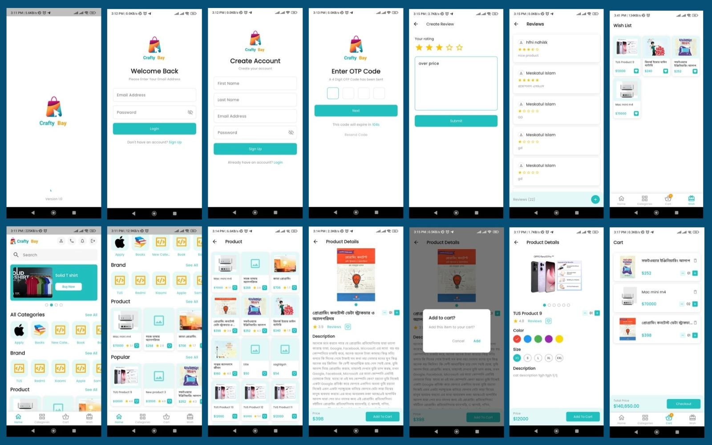

# CraftyBay

A mobile e-commerce app built with **Flutter**. Browse products by category and brand, search, read and write reviews, keep a wish list, manage a cart, and sign up with email OTP verification.

> Built as an assignment project for the [Ostad](https://ostad.app) Flutter course. The task was to build a complete shopping app against the course's REST API (the `simple-ecommerce` Postman collection).

## Screenshots



## Features

- **Authentication:** sign up, email OTP verification, login, complete profile. A saved token keeps you signed in, and an expired session sends you back to login.
- **Home:** banner carousel, categories, brands, products, and a **Popular** row ranked by customer reviews.
- **Browse:** category and brand pages, and product lists that load more as you scroll.
- **Search:** find products by name.
- **Product details:** photo carousel, color and size pickers, quantity, description, rating.
- **Reviews:** read reviews with star ratings and write your own.
- **Cart:** add items, change quantity, remove items, see the running total.
- **Wish list:** heart any product from any screen, with a confirmation before removing and a snackbar after each change.
- **Profile:** view and edit your details.
- Loading spinners, error messages with **Retry**, and image placeholders.

### Not included

Checkout and orders. The cart's **Checkout** button is a placeholder, so the app stops before placing an order.

## Tech stack

| | |
|---|---|
| Framework | Flutter (Dart) |
| State management | [`provider`](https://pub.dev/packages/provider) (`ChangeNotifier`) |
| Networking | [`http`](https://pub.dev/packages/http) behind one `NetworkCaller` class |
| Local storage | `shared_preferences` (login token) |
| Config | `flutter_dotenv` (`.env`) |
| UI | Material 3, `google_fonts` (Poppins), `flutter_svg` |
| Logging | `logger` (debug builds only) |

## Project structure

```
crafty_bay/
├── assets/images/              Logos and bundled images
├── docs/screenshots/           Screenshot used in this README
├── android/  ios/              Platform projects
├── pubspec.yaml                Dependencies and assets
├── .env.example                Template for the local .env file
└── lib/
    ├── main.dart               Entry point: loads .env, opens storage, runs the app
    │
    ├── app/                    App-level setup
    │   ├── crafty_bay_app.dart     Root MaterialApp
    │   ├── app_theme.dart          Colors, fonts, input and button styles
    │   └── app_providers.dart      Every app-wide provider, in one list
    │
    ├── core/                   Shared constants, no logic
    │   ├── app_colors.dart         Color tokens
    │   ├── app_strings.dart        All text shown in the app
    │   ├── app_assets.dart         Asset paths
    │   ├── end_points.dart         API URLs
    │   └── app_navigator.dart      Global navigator key (used by the 401 redirect)
    │
    ├── data/                   Talks to the outside world
    │   ├── model/                  JSON -> objects (product, cart item, review, ...)
    │   └── service/
    │       ├── network/            NetworkCaller (the only class using `http`),
    │       │                       auth headers, response type, request logging,
    │       │                       session-expired hook
    │       ├── cache/              CacheService: saves the login token on the device
    │       └── *_service.dart      One service per API area: auth, brand, category,
    │                               product, review, cart, wishlist, slide
    │
    ├── domain/
    │   └── entities/           Plain objects the UI works with
    │                           (Product, CartItem, Review, PageResult, ...)
    │
    └── presentation/           Everything the user sees
        ├── core/                   Shared widgets: product card, grids, dialogs,
        │                           bottom bars, image with placeholder, and the
        │                           PagedProvider base class for paged lists
        └── feature/                One folder per feature. Inside a feature:
            │                       provider/ (state), view/ (pages),
            │                       widgets/ (small widgets), and model/ when
            │                       the screen needs its own UI model.
            │                       One class per file (a StatefulWidget and
            │                       its State class stay together).
            ├── splash/
            ├── auth/               login, sign_up, otp_verification, complete_profile
            ├── main/               Bottom-navigation shell (Home, Categories, Cart, Wish)
            ├── home/               Banner, categories, brands, products
            ├── categories/         Category list
            ├── brands/             Brand list
            ├── product_list/       Products of a category, a brand, or a ranked list
            ├── search/
            ├── product_details/    Photos, color, size, quantity, add to cart
            │                       (model/ holds the screen's UI model)
            ├── reviews/            Review list, star rating, ratings for cards
            ├── create_review/
            ├── cart/
            ├── wishlist/
            └── profile/            View and edit profile
```

### How the layers connect

```
 Page (view)  ->  Provider  ->  Service  ->  NetworkCaller  ->  REST API
     ^               |             |
     |               |             +-- Model: JSON -> Entity
     +-- rebuilds <--+
```

- A **page** shows data and reacts to taps. It never calls the API itself.
- A **provider** holds the state of one feature (loading, error, data) and notifies the page when it changes.
- A **service** knows one API area: which URL to call and how to read the answer.
- **NetworkCaller** is the only code that uses the `http` package. It adds timeouts, logging and error handling.

### Design choices

- **Pagination:** `PagedProvider` is a reusable base class, so every long list loads page by page the same way.
- **Errors:** the API's `{"msg": "..."}` errors are shown as readable messages, with a Retry button where it makes sense.
- **Auth:** the API expects the JWT in a `token` header, not `Authorization: Bearer`. A 401 on any signed-in request clears the token and opens the login page.
- **Shared values in one place:** app colors, text, asset paths and API URLs live in `core/` instead of being repeated in widgets.

## API

The app uses the customer endpoints of the course API: auth, brands, categories, products, reviews, cart, wishlist and slides. Admin-only routes are not used.

### Known limitations

- The API ignores the `product` filter on `/reviews`, so the app downloads all reviews once, shares them between screens, and filters on the device. This is fine for a small shop. A larger one would need the backend to filter by product.
- Search runs on the phone, because the API has no text search.
- Orders and checkout are not built yet.

## Author

**Rahat Alamgir** · [GitHub](https://github.com/RahatAlamgir)
